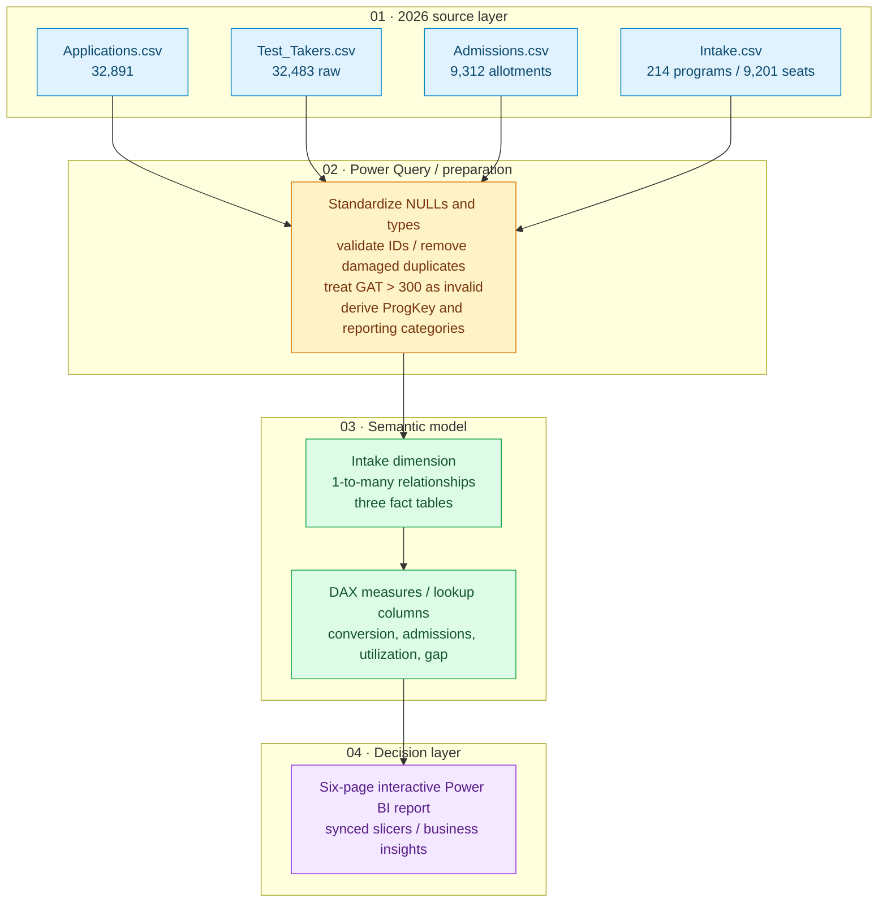
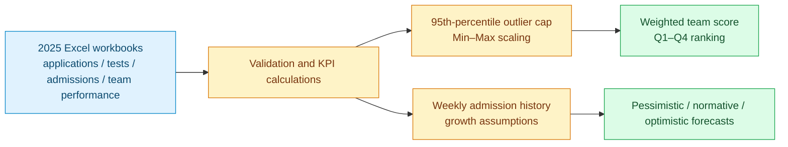
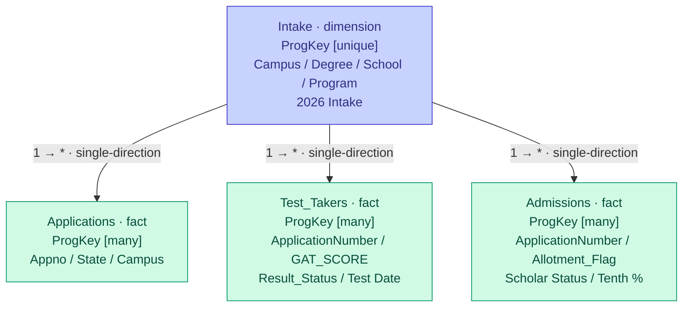

🎓 GITAM University | Admissions Analytics & Performance Dashboard
From fragmented admissions records to actionable enrollment, capacity and performance insights
   
Business Analytics Portfolio Case Study | 2026 Power BI Dashboard + Separate 2025 Excel Analysis
Attribution: Independent analytics assignment/case study using GITAM-branded materials, not an official GITAM publication or endorsement. Branding is retained to reflect the supplied project. Publishing university materials requires appropriate permission.

📌 Executive summary — what this project represents
An end-to-end admissions performance analytics solution designed to help university admissions, marketing and leadership teams understand where applicants drop out of the funnel, which campuses and programs need intervention, whether seats are being utilized, and how to plan admissions activity.

The project has two distinct workstreams:
1. 2026 Power BI reporting: four CSV datasets → data quality checks → Power Query transformations → a program-level dimensional model → DAX measures → six interactive dashboard pages.
2. 2025 Excel operational analytics: separate workbooks → weighted performance scoring for 53 team members → quartile segmentation → weekly scenario-based admissions forecast.
This is a decision-support analytics project, not a marketing attribution or campaign ROI model. The provided datasets support geography, application demand and conversion analysis, but do not establish channel spend, campaign-level ROI or cost per lead.
📊 Dashboard preview

<strong>View all six report pages</strong>
1. Main Dashboard — leadership snapshot

2. Admissions Funnel — conversion and drop-off

3. Application Analysis — demand, geography and campus mix

4. Test-Taker Analysis — qualification, absences and GAT scores

5. Admissions vs Intake — capacity and unfilled seats

6. Admitted Student Profile — admitted cohort characteristics

🎯 Business problems and decisions supported
Business question	Analytical solution	Decision supported
Where are we losing qualified prospects?	Application → test → qualification → admission funnel	Prioritize post-qualification follow-up and conversion improvement
Which campuses convert best?	Campus-level conversion comparisons	Focus coaching and operational investigation where conversion is lower
Where is demand concentrated?	State, campus, program and test-activity views	Align outreach and admissions capacity with observed demand
Which programs have unused capacity?	Intake vs confirmed admissions, utilization and seat gap	Review program-specific recruitment and seat planning
How are counseling teams performing?	Weighted KPI composite and quartile ranking (2025)	Target coaching and recognize high performers
How many admissions might arrive by the deadline?	Pessimistic / normative / optimistic forecast (2025)	Support scenario planning and resource allocation

🔢 2026 KPI scorecard
Metric	Result	Definition / interpretation
Applications	32,891	Application records
Test takers	32,476	Clean test-taker records
Qualified	26,070	Qualified test records
Confirmed admissions	7,629	Allotment_Flag = Admitted; cancellations excluded
Intake	9,201	Available program seats
Seat utilization	82.91%	Confirmed admissions / intake
Application → test taker	98.74%	Aggregate stage-count ratio
Test taker → qualified	80.27%	Aggregate stage-count ratio
Qualified → admission	29.26%	Aggregate stage-count ratio

Interpretation note: These conversion rates are ratios of stage totals. Program assignment changes and source inconsistencies mean they should not be presented as a fully reconciled, student-level cohort conversion analysis.

🧱 End-to-end workflow and architecture

2025 Excel analysis — independent parallel workflow

🗂️ Power BI data modeling — schema and relationship design
Model type: program-centered dimensional model with Intake as the dimension and Applications, Test_Takers and Admissions as fact tables. This is a star-like reporting model, not a fully conformed enterprise star schema.

From	To	Join key	Cardinality	Filter direction
Intake	Applications	ProgKey	1:*	Single
Intake	Test_Takers	ProgKey	1:*	Single
Intake	Admissions	ProgKey	1:*	Single

Why this design? ProgKey is a normalized Campus | Program combination (uppercase, trimmed). The intake table supports common program filtering without adding potentially ambiguous fact-to-fact relationships. Disconnected Funnel Stages and Metrics helper tables support report visuals. The design document also describes application-number-based LOOKUPVALUE columns for admissions state and GAT score.

Trade-off: There is no date dimension because application and allotment date fields were unusable in the supplied files. The monthly chart uses test dates, so it must be labeled as test activity rather than a verified application-date trend.
🧹 Data quality, transformation and validation
Issue found	Documented handling	Why it matters
Text NULL values	Standardized to blanks	More consistent filtering and analysis
IDs stored inconsistently	Converted identifiers to text	Preserve identifiers and avoid type errors
Damaged / duplicate test IDs	Removed 7 records (32,483 → 32,476)	Cleaner test-taker count
GAT scores over 300	Treated 182 implausible values as invalid	Avoid distorting score analysis
Inconsistent campus / program strings	Created normalized ProgKey	Enable program-level relationships
Cancelled allotments	Excluded 1,683 from confirmed admissions	Avoid overstating admissions
Unusable application/allotment dates	Used test dates for monthly activity	Prevent misleading date interpretation
Program mismatches	Documented ratios above 100% and unmatched programs	Flag unresolved reconciliation limitations

Reconciliation example: 9,312 allotment records − 1,683 cancellations = 7,629 confirmed admissions. The reported 1,572-seat gap is 9,201 capacity − 7,629 admissions. Some program-level intake gaps require further mapping validation.
📈 Dashboard pages — what users can see
Page	What it shows	Business value
Main Dashboard	Applications, test takers, qualified, admissions, intake, utilization, geography and trends	Executive monitoring
Admissions Funnel	Stage conversion, campus comparisons and school/program breakdown	Identify bottlenecks
Application Analysis	State, campus, degree and dated test-activity patterns	Understand demand mix
Test-Taker Analysis	Qualified, absent, rejected, PI pending and GAT scores	Improve test and interview follow-up
Admissions vs Intake	Seat capacity, utilization, unfilled-seat gap by campus/program	Capacity planning
Admitted Student Profile	Student demographics, scores, board and scholarship indicators	Understand admitted cohort

💡 Findings → implications → recommended actions
Evidence	Business implication	Proposed action / metric
29.26% of qualified candidates converted to admissions	Largest visible funnel loss occurs after qualification	Segment by campus/program; track qualified-to-admitted conversion weekly
BLR 43.2% qualified-to-admission vs HYD 28.2% and VSP 27.3%	Different campus conversion patterns	Review follow-up processes and program mix; compare conversion over time
520 unfilled CSE seats across three campuses	Concentrated capacity opportunity	Investigate demand and enrollment barriers; monitor CSE seat gap
3,680 absent test takers and 608 PI pending	Follow-up and interview-completion opportunities	Track test attendance and PI pending aging
March = 33% of dated test records; March–May ≈ 77%	Operational activity is seasonally concentrated	Plan staffing around verified test activity, not assumed application dates
45 of 214 programs below 50% utilization (subject to mapping limitations)	Long tail of underused capacity	Validate mappings before targeting program-level action

Recommendations are analytical proposals, not claims that interventions were implemented or that they produced measured uplift.
📐 Excel analytics — 2025 operational workstream
Team performance quartiles
- Evaluated 53 team members using three KPIs: application-to-admission conversion (50%), achievement against plan (25%), and application-to-test conversion (25%).
- Applied a 95th-percentile cap for high outliers and Min–Max normalization before calculating the weighted score.
- Ranked members and divided them into Q1–Q4 (13 / 13 / 13 / 14 according to the report's quartile description; actual group sizes should be confirmed from the final workbook before publishing).
- Intended use: compare performance more fairly and identify coaching opportunities; do not publish identifiable employee-level rankings without permission.
Composite scoring logic:

Score = 0.50 × normalized(App→Adm%) + 0.25 × normalized(Actual%) + 0.25 × normalized(App→TT%)
Weekly scenario forecast
The separate 2025 analysis projects cumulative admissions through 17 July 2025:
Scenario	Forecast admissions	Use
Pessimistic	4,789	Downside resource planning
Normative	6,846	Working planning baseline
Optimistic	9,484	Upside capacity scenario

The model uses recent weekly admission growth and different scenario assumptions. These are forecasts, not actual results; no forecast accuracy or causal campaign impact is claimed.
📁 Repository structure and file guide
GITAM-Admissions-Analytics/
│
├── README.md
│
├── screenshots/
│   ├── main_dashboard.png
│   ├── admissions_funnel.png
│   ├── application_analysis.png
│   ├── test_taker_analysis.png
│   ├── admissions_vs_intake.png
│   └── admitted_student_profile.png
│
├── dashboard/
│   └── GITAM_Admission_Analysis.pdf                  [optional; approval required]
│
├── documentation/
│   ├── GITAM_Admissions_One_Page_Summary.pdf         [optional; approval required]
│   └── GITAM_Dashboard_Design_Document_Updated.pdf  [optional; review required]
│
├── presentation/
│   └── GITAM_Admissions_Project_Presentation.pptx   [optional; approval required]
│
├── excel/
│   └── Priyanka_Lenka_GITAM_BA_Assignment.xlsx       [DO NOT publish original without sanitizing]
│
└── .gitignore
Repository packaging note: The public-safe starter package includes this README and six dashboard PNGs. The PDF, PowerPoint and original Excel files are listed above as possible additions, not as files already included. Their publication depends on authorization and review. A .pbix file was not supplied and is not claimed to be available.
🔍 Limitations and next steps
- Data provenance: Project documents describe an assignment; no evidence is provided of production deployment, automated refresh, scheduled monitoring or stakeholder adoption.
- Reproducibility: Source CSVs and the .pbix were not supplied, so the repository is a documented portfolio showcase, not a runnable solution.
- Conversion measurement: Aggregate funnel ratios should be reconciled at the applicant level before interpreting true transitions.
- Program matching: Program-name changes can cause over-100% ratios or unmatched admissions; a controlled program mapping table would improve reliability.
- Forecast validation: Back-test scenarios against observed weekly results when those records are available.
- Data governance: Exclude identifiable student and employee records, internal documents, and proprietary datasets without explicit authorization.
👤 Project ownership and skills demonstrated
Prepared by: Priyanka Lenka
Project type: University admissions business analytics assignment / portfolio case study
Skills: Power BI, Power Query, DAX, Excel, KPI design, data quality, dimensional modeling, admissions funnel analytics, scenario forecasting, reporting documentation and business recommendations.
This repository demonstrates analytical methodology and reporting artifacts. It does not claim an official GITAM endorsement, verified commercial outcomes, or production-system ownership.
