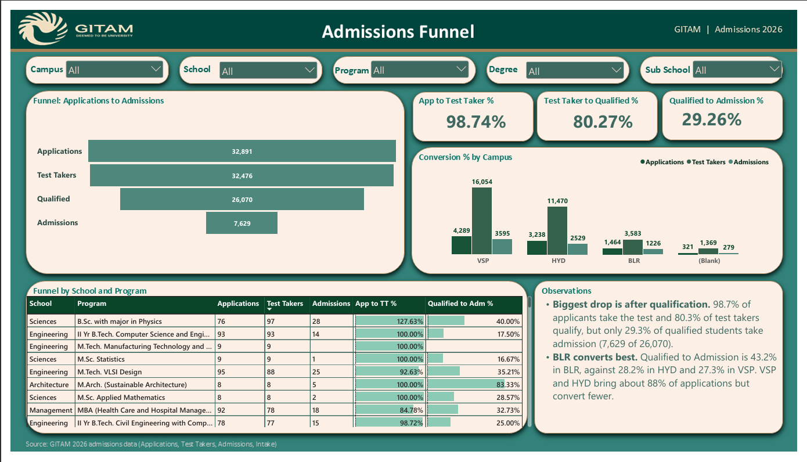

# 🎓 GITAM University | Admissions Analytics & Performance Dashboard

### Transforming Admissions Data into Actionable Business Insights

**Project Type:** End-to-End Business Analytics & Reporting  
**Domain:** Higher Education | Admissions | Marketing Performance  
**Technologies:** Power BI, Power Query, DAX, Microsoft Excel  
**Developed By:** Priyanka Lenka

---

## 📌 1. Executive Summary

This project presents an end-to-end **University Admissions Analytics and Performance Monitoring Solution**, developed to transform admissions data into actionable insights for university leadership, admissions teams, and marketing operations.

The solution focuses on identifying conversion bottlenecks, monitoring student recruitment performance, analyzing campus and program-level demand, evaluating seat utilization, and supporting admissions planning.

The project consists of two analytical workstreams:

**Power BI Admissions Dashboard — 2026**

- Data ingestion and transformation from four CSV datasets.
- Data cleaning and validation using Power Query.
- Dimensional data modeling and DAX KPI development.
- Six-page interactive Power BI dashboard.
- Admissions funnel, campus performance, intake utilization, and student profile analysis.

**Excel Operational Analytics — 2025**

- Performance evaluation of 53 admissions team members.
- Weighted KPI scoring and quartile segmentation.
- Weekly admissions forecasting.
- Pessimistic, normative, and optimistic scenario analysis.

The two workstreams use separate admission cycles and are presented independently.

### What this project represents

This is not simply a Power BI visualization project. It demonstrates the complete analytical lifecycle:

**Business Requirements → Data Understanding → Data Cleaning → Data Modeling → KPI Development → Visualization → Business Insights → Recommendations**

The project supports data-driven decisions across admissions operations, student recruitment, and capacity planning.

---

## 📊 2. Dashboard Preview

### Complete Power BI Dashboard

**1. Main Dashboard — Executive Overview**

Provides an overview of applications, test takers, qualified students, confirmed admissions, intake capacity, and seat utilization.

**2. Admissions Funnel — Conversion Analysis**

Identifies conversion rates and drop-offs across the admissions journey.

**3. Application Analysis — Demand and Geography**

Analyzes campus demand, geographic distribution, program preferences, and test activity
