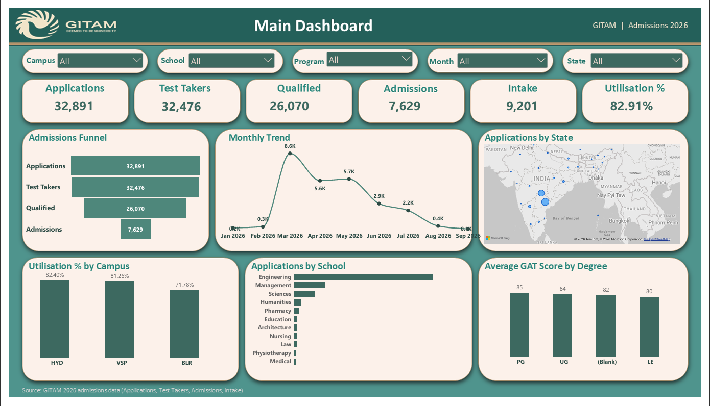
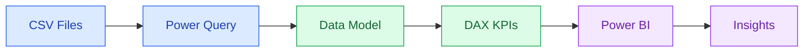
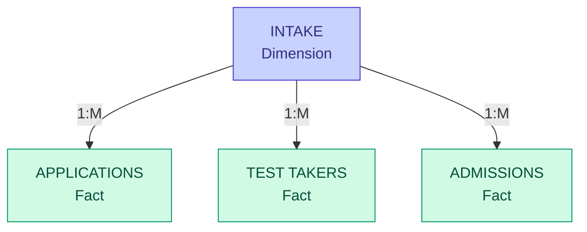
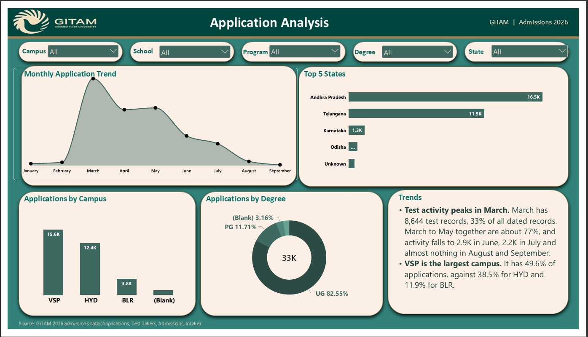

<div align="center">

# 🎓 GITAM University
## Admissions Analytics & Performance Dashboard

### Turning Admissions Data into Business Decisions


**Business Intelligence | Data Modeling | Funnel Analytics | Forecasting**

</div>

---

## 📌 1. Project Overview

This project presents an end-to-end **University Admissions Analytics Solution** designed to help admissions teams, management, and university leadership monitor recruitment performance, understand admission conversion, evaluate campus-level demand, and identify opportunities to improve seat utilization.

The project combines two independent analytical workstreams:

- **2026 Power BI Admissions Analytics:** Data preparation, dimensional modeling, KPI development, and six interactive dashboards.
- **2025 Excel Operational Analytics:** Team performance evaluation, weighted quartile analysis, and weekly admissions forecasting.

### What Does This Project Represent?

The project demonstrates the complete business analytics lifecycle:

**Business Understanding → Data Preparation → Modeling → KPI Development → Reporting → Insights → Recommendations**

It focuses not only on creating dashboards, but also on answering business questions and supporting data-driven decision-making.

### Technology Stack

| Area | Technologies |
|---|---|
| Data Sources | CSV, Excel |
| Data Preparation | Power Query |
| Data Modeling | Power BI Relationships |
| Calculations | DAX, Excel Formulas |
| Visualization | Power BI |
| Forecasting | Excel Scenario Analysis |
| Documentation | PDF, PowerPoint |

---

## 📊 2. Executive Dashboard



### Key Performance Indicators — 2026

| KPI | Value |
|---|---:|
| Total Applications | **32,891** |
| Test Takers | **32,476** |
| Qualified Candidates | **26,070** |
| Confirmed Admissions | **7,629** |
| Total Intake Capacity | **9,201** |
| Seat Utilization | **82.91%** |
| Application-to-Test Ratio | **98.74%** |
| Test-to-Qualification Ratio | **80.27%** |
| Qualified-to-Admission Ratio | **29.26%** |

**Business interpretation:** The university achieved 82.91% overall seat utilization. The 29.26% qualified-to-admission ratio highlights a potential post-qualification conversion bottleneck requiring further investigation.

> Conversion percentages are aggregate stage-count ratios. They should not be interpreted as fully reconciled applicant-level conversion rates.

---

## 🎯 3. Business Problems Addressed

The project was designed to answer six important business questions.

| Business Problem | Analytical Solution | Business Value |
|---|---|---|
| Where are applicants dropping out? | Admissions funnel | Identify conversion bottlenecks |
| Which campuses perform better? | Campus performance analysis | Compare admissions effectiveness |
| Which programs attract more demand? | Application analysis | Support recruitment planning |
| Which programs have unfilled seats? | Admissions vs Intake | Improve capacity planning |
| How are team members performing? | Weighted KPI quartiles | Support performance coaching |
| How many admissions can be expected? | Scenario forecasting | Support resource planning |

### Primary Business Objectives

1. Monitor end-to-end admissions performance.
2. Identify conversion gaps across the admissions journey.
3. Analyze application demand by campus and program.
4. Measure seat utilization against intake capacity.
5. Evaluate admissions team performance.
6. Support admissions planning through forecasting.

---

## 🏗️ 4. End-to-End Analytics Workflow

### Compact Technical Architecture



### Workflow Explanation

| Stage | Activities |
|---|---|
| 1. Data Collection | Import Applications, Test_Takers, Admissions, and Intake CSV files |
| 2. Data Profiling | Identify missing values, duplicates, invalid scores, and inconsistencies |
| 3. Transformation | Clean data and standardize program keys using Power Query |
| 4. Data Modeling | Build relationships between dimension and fact tables |
| 5. KPI Development | Create DAX measures for conversion and utilization |
| 6. Visualization | Develop six interactive Power BI dashboard pages |
| 7. Business Analysis | Identify trends, bottlenecks, and capacity gaps |
| 8. Recommendations | Translate analytical findings into proposed business actions |

---

## 🗂️ 5. Data Sources

The 2026 Power BI dashboard uses four CSV datasets.

| Dataset | Records | Description |
|---|---:|---|
| Applications | 32,891 | Applicant details, campus, program, and geography |
| Test_Takers | 32,483 raw | Test participation, scores, and qualification status |
| Admissions | 9,312 | Allotments, cancellations, and confirmed admissions |
| Intake | 214 programs | Program-level intake capacity |

### Data Preparation and Quality Checks

Power Query transformations included:

- Standardizing null values and data types.
- Converting application identifiers to text.
- Removing seven damaged or duplicate test records.
- Treating 182 implausible GAT scores above 300 as invalid.
- Standardizing campus and program names.
- Creating a normalized `ProgKey`.
- Distinguishing confirmed admissions from cancelled allotments.
- Documenting limitations in date and program mapping fields.

### Data Reconciliation

| Validation | Calculation | Result |
|---|---|---:|
| Clean Test Records | 32,483 − 7 | 32,476 |
| Confirmed Admissions | 9,312 − 1,683 cancellations | 7,629 |
| Net Seat Gap | 9,201 − 7,629 | 1,572 |

These checks help prevent misleading reporting and improve the reliability of business KPIs.

---

## 🗄️ 6. Power BI Data Modeling

### Compact Data Model



### Modeling Approach

The Power BI model uses a **program-centered dimensional structure**.

The Intake table acts as the central dimension, connected to three fact tables through a standardized program key.

| Table | Type | Key Fields |
|---|---|---|
| Intake | Dimension | ProgKey, Campus, School, Program, Intake |
| Applications | Fact | Application Number, ProgKey, State |
| Test_Takers | Fact | Application Number, ProgKey, GAT Score, Result Status |
| Admissions | Fact | Application Number, ProgKey, Allotment Flag |

### Relationship Configuration

| From | To | Relationship | Filter Direction |
|---|---|---|---|
| Intake | Applications | One-to-Many | Single |
| Intake | Test_Takers | One-to-Many | Single |
| Intake | Admissions | One-to-Many | Single |

### Why This Model?

The model was designed to:

- Support campus and program-level filtering.
- Avoid unnecessary direct fact-to-fact relationships.
- Enable reusable KPI measures.
- Simplify reporting and analysis.
- Support conversion and capacity comparisons.

The structure is **star-like**, rather than a fully conformed enterprise star schema.

**Modeling limitation:** Program changes and inconsistent program names can create unmatched records. A controlled program mapping table would improve future reconciliation.

---

## ⚙️ 7. KPI Development and DAX

DAX measures were used to calculate important admissions metrics.

| KPI | Calculation Logic |
|---|---|
| Total Applications | Count of application records |
| Total Test Takers | Count of cleaned test records |
| Qualified Candidates | Count of qualified records |
| Confirmed Admissions | Count of admitted records |
| Application-to-Test % | Test Takers / Applications |
| Test-to-Qualification % | Qualified / Test Takers |
| Qualified-to-Admission % | Admissions / Qualified |
| Seat Utilization % | Admissions / Intake |
| Seat Gap | Intake − Admissions |

### Business Importance

These KPIs enable stakeholders to evaluate recruitment performance, identify conversion gaps, and monitor seat capacity at campus and program levels.

---

## 📈 8. Power BI Dashboard Analysis

The solution contains six dashboard pages.

### 8.1 Main Dashboard — Executive Overview


**Purpose:** Provide leadership with a consolidated view of university admissions performance.

**What can be analyzed:**

- Total applications.
- Test participation.
- Qualified candidates.
- Confirmed admissions.
- Intake capacity.
- Seat utilization.
- Campus and geographic distribution.

**Business value:** Enables management to monitor admissions performance through a centralized reporting interface.

---

### 8.2 Admissions Funnel — Conversion Analysis


**Purpose:** Identify conversion bottlenecks across the admissions lifecycle.

The dashboard analyzes the progression from applications to test takers, qualified candidates, and confirmed admissions.

#### Campus Conversion Comparison

| Campus | Qualified-to-Admission Ratio |
|---|---:|
| Bengaluru | 43.2% |
| Hyderabad | 28.2% |
| Visakhapatnam | 27.3% |

**Key finding:** Bengaluru showed the highest qualified-to-admission ratio.

**Business recommendation:** Investigate differences in campus follow-up practices, program mix, and candidate engagement.

---

### 8.3 Application Analysis — Demand and Geography



**Purpose:** Understand application demand and geographic distribution.

#### Key Findings

- Andhra Pradesh and Telangana contributed approximately 84.4% of applications.
- Visakhapatnam accounted for approximately 49.6%.
- Hyderabad accounted for approximately 38.5%.
- Bengaluru accounted for approximately 11.9%.

**Business recommendation:** Use geographic and campus demand patterns to inform recruitment planning.

The dated activity analysis uses test dates, not verified application dates.

---

### 8.4 Test-Taker Analysis — Qualification Performance

![Test Taker Analysis]

**Purpose:** Evaluate test participation and qualification outcomes.

| Metric | Value |
|---|---:|
| Qualified | 26,070 |
| Absent | 3,680 |
| Rejected | 2,118 |
| PI Pending | 608 |

**Business insight:** Absent candidates and pending interviews represent potential follow-up opportunities.

**Recommended action:** Monitor test attendance and pending interview completion.

---

### 8.5 Admissions vs Intake — Capacity Utilization

![Admissions vs Intake]

**Purpose:** Evaluate admissions performance against program capacity.

| Metric | Value |
|---|---:|
| Total Intake | 9,201 |
| Confirmed Admissions | 7,629 |
| Utilization | 82.91% |
| Net Unfilled Seats | 1,572 |

**Key finding:** B.Tech Computer Science and Engineering had a combined gap of 520 seats across three campuses.

**Business recommendation:** Investigate program-level enrollment barriers and review recruitment priorities.

Program-level findings should be validated against known mapping inconsistencies.

---

### 8.6 Admitted Student Profile — Student Characteristics

![Admitted Student Profile]

**Purpose:** Understand the composition of admitted students.

The dashboard provides analysis of:

- Gender distribution.
- Geographic distribution.
- Academic board.
- GAT score.
- Scholarship indicators.

**Business value:** Supports student profile analysis and future admissions planning.

---

## 📊 9. Excel Analytics — Team Performance

The separate 2025 Excel analysis evaluated 53 admissions team members using a weighted KPI scoring framework.

### KPI Weight Distribution

| KPI | Weight |
|---|---:|
| Application-to-Admission Conversion | 50% |
| Actual Achievement Against Plan | 25% |
| Application-to-Test Conversion | 25% |

### Analytical Methodology

1. Validate employee performance data.
2. Cap high outliers at the 95th percentile.
3. Apply Min–Max normalization.
4. Calculate weighted performance scores.
5. Rank team members.
6. Segment performance into quartiles.

### Composite Score

`Score = 0.50 × Normalized(App-to-Adm%) + 0.25 × Normalized(Actual%) + 0.25 × Normalized(App-to-TT%)`

### Business Value

This analysis provides a standardized approach for performance evaluation, coaching prioritization, and identifying higher-performing team members.

Identifiable employee-level results are not intended for public release.

---

## 🔮 10. Excel Admissions Forecasting

The 2025 forecasting analysis estimated cumulative admissions using historical weekly performance and scenario assumptions.

### Compact Forecasting Workflow


### Forecast Results — 17 July 2025

| Scenario | Forecast Admissions |
|---|---:|
| Pessimistic | 4,789 |
| Normative | 6,846 |
| Optimistic | 9,484 |

### Business Applications

- Admissions capacity planning.
- Resource allocation.
- Monitoring expected admissions.
- Preparing for downside and upside scenarios.

**Note:** These are forecast estimates, not actual admissions outcomes. Forecast accuracy has not been independently validated.

---

## 💡 11. Business Insights and Recommendations

| Business Finding | Implication | Recommended Action |
|---|---|---|
| 29.26% qualified-to-admission ratio | Potential post-qualification bottleneck | Investigate candidate follow-up and conversion barriers |
| Bengaluru has the highest conversion ratio | Campus-level performance differences | Compare operating practices and program mix |
| 520 unfilled CSE seats | Concentrated capacity gap | Review program-specific recruitment challenges |
| 3,680 absent test takers | Potential engagement issue | Investigate absence reasons and follow-up |
| 608 PI Pending candidates | Incomplete interview pipeline | Monitor pending interviews and completion |
| 82.91% seat utilization | Remaining capacity | Track campus and program utilization |

### Recommended Business Monitoring KPIs

- Qualified-to-Admission Conversion.
- Test Attendance Rate.
- Pending Interview Count.
- Program Seat Utilization.
- Admission Funnel Drop-off.
- Actual vs Forecast Variance.

These recommendations are proposed actions, not claims of implemented business improvements.

---

## 📁 12. GitHub Repository Structure

```text
GITAM-Admissions-Analytics/
│
├── README.md
│
├── screenshots/
│   ├── main_dashboard.png
│   ├── admissions_funnel.png
│   ├── application_analysis.png
│   ├── test_taker_analysis.png
│   ├── admissions_vs_intake.png
│   └── admitted_student_profile.png
│
├── dashboard/
│   └── GITAM_Admission_Analysis.pdf
│
├── documentation/
│   ├── GITAM_Admissions_One_Page_Summary.pdf
│   └── GITAM_Dashboard_Design_Document_Updated.pdf
│
├── presentation/
│   └── GITAM_Admissions_Project_Presentation.ppt
```

### File Descriptions

| File / Folder | Description |
|---|---|
| `README.md` | Project overview, methodology, modeling, and findings |
| `screenshots/` | Six Power BI dashboard screenshots |
| `GITAM_Admission_Analysis.pdf` | Six-page dashboard export |
| `GITAM_Admissions_One_Page_Summary.pdf` | Executive summary of findings |
| `GITAM_Dashboard_Design_Document_Updated.pdf` | Technical design and modeling documentation |
| `GITAM_Admissions_Project_Presentation.pptx` | Project presentation |


**Repository note:** This is the intended folder structure. The original PDF, PowerPoint, and Excel files should be uploaded only after confirming publication permission and reviewing confidential information. Do not publish identifiable student or employee data.

---

## ⚠️ 13. Limitations and Future Improvements

### Current Limitations

- Inconsistent program names across datasets.
- Some program-level ratios exceed 100% due to mapping differences.
- Unreliable application and allotment dates.
- Aggregate conversion ratios are not fully reconciled at applicant level.
- Forecast accuracy has not been independently back-tested.
- Original source CSVs and the Power BI `.pbix` file are not included in the supplied portfolio materials.

### Future Enhancements

- Create a controlled program mapping dimension.
- Implement applicant-level funnel reconciliation.
- Add a dedicated date dimension when reliable dates are available.
- Improve data quality validation and exception reporting.
- Validate forecast accuracy against actual results.
- Extend analysis to recruitment channels if appropriate source data becomes available.

---

## 🏆 14. Skills Demonstrated

| Category | Skills |
|---|---|
| Data Preparation | Power Query, Cleaning, Validation |
| Data Modeling | Dimensional Modeling, Relationships |
| Business Intelligence | Power BI, DAX, KPI Development |
| Analytics | Funnel Analysis, Conversion, Capacity |
| Excel | Weighted Scoring, Quartiles, Forecasting |
| Communication | Documentation, Business Recommendations |

---

## 👤 15. Project Information

**Developed by:** Priyanka Lenka

**Project:** GITAM University Admissions Analytics & Performance Dashboard

**Domain:** Higher Education Analytics

**Tools:** Power BI, Power Query, DAX, Microsoft Excel

### Project Summary

This project demonstrates how admissions data can be transformed into a structured business intelligence solution through data preparation, dimensional modeling, KPI development, dashboard reporting, performance analysis, and scenario-based forecasting.

It highlights the use of analytical methods to identify operational gaps and support admissions planning.

**Disclaimer:** This repository represents an independent analytics assignment and portfolio case study, not an official GITAM University publication or endorsement. University branding and project materials should only be published with appropriate authorization.

---

<div align="center">

### ⭐ From Raw Data to Actionable Business Insights

**Data Preparation | Data Modeling | Business Intelligence | Forecasting**

</div>
